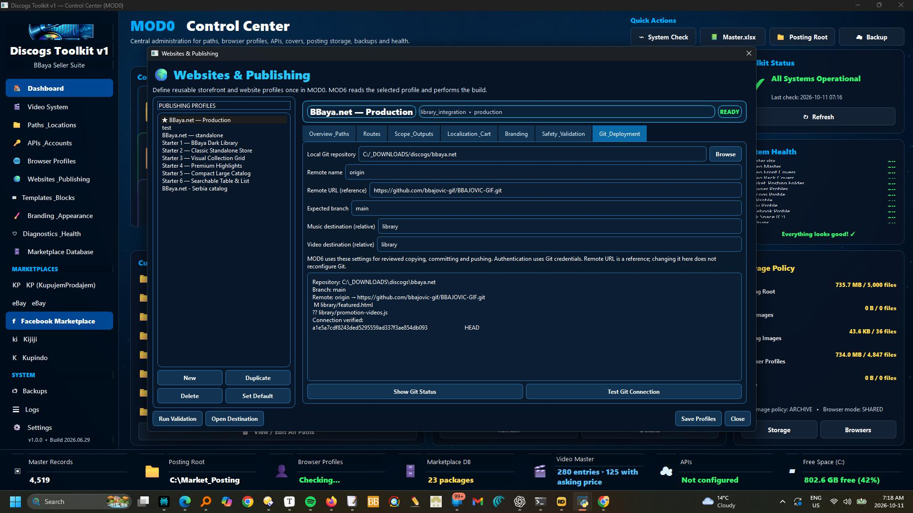
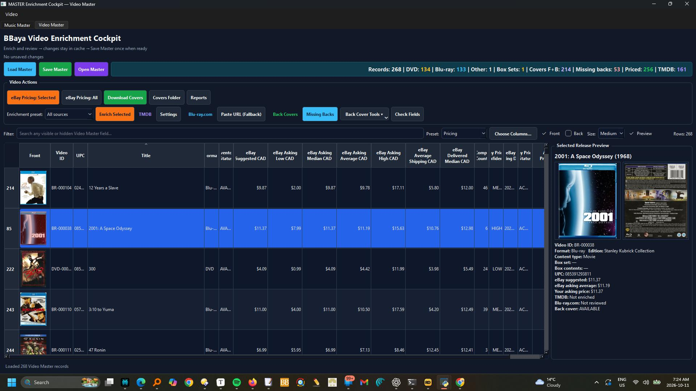
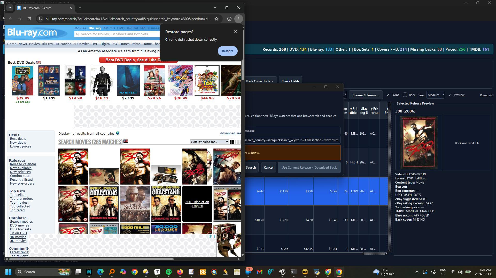
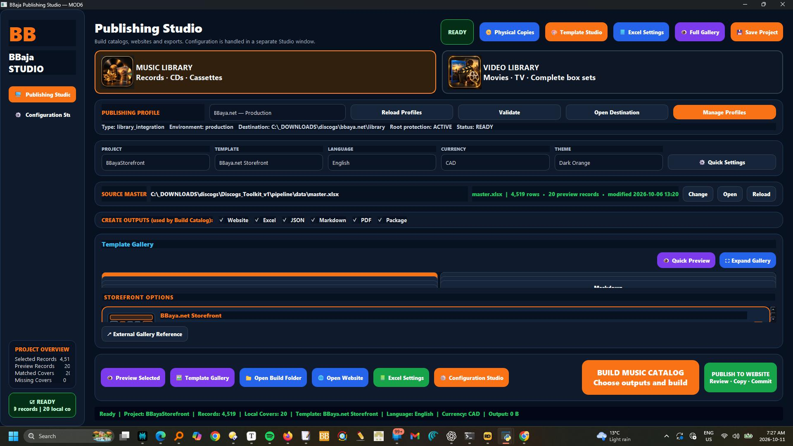
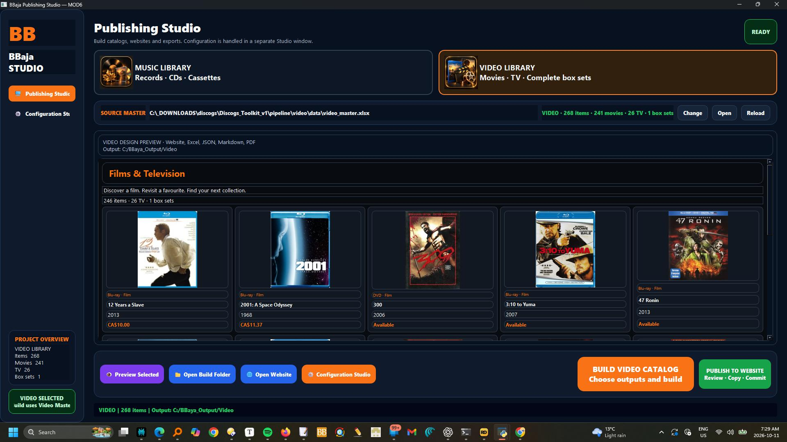
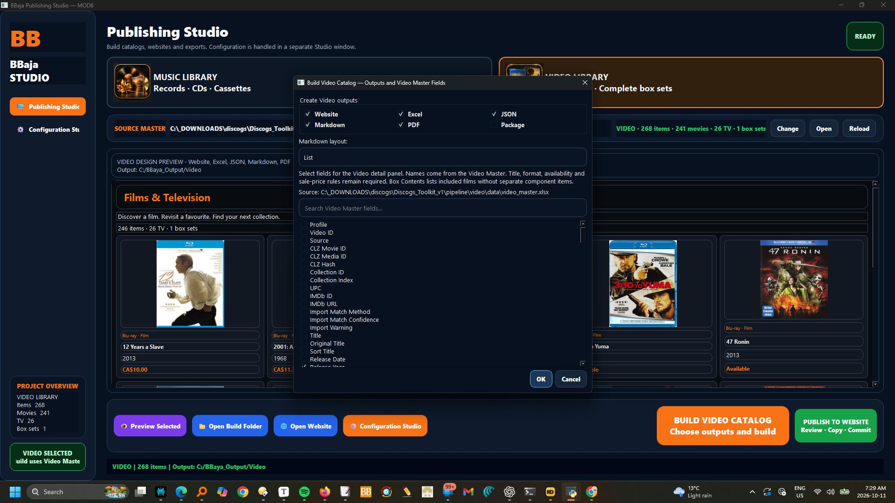

# Discogs Toolkit v1 - User Manual

This manual explains the complete Discogs Toolkit from a user perspective.

It is written for daily use: what each module is for, what the main commands do, and what each action accomplishes. It avoids internal code details unless the file or folder name is useful for finding something.

## What The Suite Does

Discogs Toolkit v1 helps manage a music collection and selling workflow from start to finish.

The suite is organized around this flow:

```text
Import records
  -> clean and normalize them
  -> enrich missing information
  -> manage inventory and sales
  -> research market value and prepare listings
  -> publish catalogs and storefront exports
```

The main working file is your master collection spreadsheet:

```text
pipeline/data/master.xlsx
```

Most modules either read from it, compare against it, improve it, or use it to create selling/catalog outputs.

## Main Launcher

Start the suite with:

```bat
py run_modules.py
```

The launcher is the front door for the whole toolkit. It shows:

- `MOD0` Control Center
- `MOD1` Import & Reconcile
- `MOD2` Normalize & Assign Sort
- `MOD3` Master Enrichment
- `MOD4` Inventory & Sales Cockpit
- `MOD5` Market Research & Monetization
- `MOD6` Catalog & Publishing

### Launcher Commands

`MOD0 Control Center`

Opens the settings and system dashboard. Use it before work sessions to confirm paths, folders, profiles, templates, and local setup.

`MOD1 Import & Reconcile`

Starts the import/reconciliation cockpit.

`MOD2 Normalize & Assign Sort`

Starts the data cleanup cockpit.

`MOD3 Master Enrichment`

Starts the enrichment cockpit.

`MOD4 Inventory & Sales Cockpit`

Starts the inventory and sales management cockpit.

`MOD5 Market Research & Monetization`

Starts the pricing, marketplace research, and listing-preparation tool.

`MOD6 Catalog & Publishing`

Opens Publishing Studio to select a publishing profile, preview a project, and build catalog outputs.

`DATA FOLDER`

Opens the live data folder where master files, backups, covers, and related working files are stored.

`TOOLKIT ROOT`

Opens the main Discogs Toolkit folder.

`ABOUT`

Shows a short description of the suite and module list.

## Recommended Daily Workflow

For collection maintenance:

```text
MOD1 -> MOD2 -> MOD3 -> MOD4
```

For selling and publishing:

```text
MOD4 -> MOD5 -> MOD6
```

For setup or troubleshooting:

```text
MOD0
```

You do not need to run every module every time. Use the module that matches the job you are doing.

# MOD0 - Control Center

MOD0 is the control room for the whole suite.

Use MOD0 to check whether the toolkit is ready before starting real work. It helps with paths, folders, accounts, browser profiles, templates, branding, backups, logs, and health checks.

## Main Purpose

MOD0 answers:

- Is the master file available?
- Are the Market_Posting folders available?
- Are browser profile folders set up?
- Are templates and branding assets present?
- Where are my settings, logs, backups, and folders?
- Is the toolkit ready for a work session?

## Main Commands

`System Check`

Runs a health check. It verifies key paths, master file availability, posting folders, browser profiles, and related setup. Use this when something feels off or before a bigger work session.

`Open Master`

Opens `master.xlsx`. Use this only for inspection unless you are intentionally making manual spreadsheet edits.

`Open Market_Posting`

Opens the external posting workspace used for templates, packages, browser profiles, and marketplace outputs.

`Create Backup`

Creates a timestamped backup copy of the master file. Use this before major imports, repairs, sales updates, or experiments.

`Paths & Locations`

Opens the path editor. Use this to set or change the Market_Posting root folder and other important locations.

`APIs & Accounts`

Shows local account/config locations for Discogs and marketplace services. It does not display private token values. Use it to find where account settings live.

`Browser Profiles`

Shows browser profile folders for KP, Discogs, eBay, Facebook, Kupindo, and Kijiji. Use these folders when login/session reuse matters for automation or posting.

`Templates & Blocks`

Opens template folders used for marketplace listings, posting text, and catalog output.

`Branding & Appearance`

Opens logo, launcher artwork, and branding asset folders. Use this when changing visual identity or catalog artwork.

`Diagnostics & Health`

Runs diagnostics and shows the current health state.

`Backups`

Opens the backup folder.

`Logs`

Opens the MOD0 activity log.

`Settings`

Opens the user path settings file.

`Clear Cache`

Deletes temporary/cache files used by parts of the toolkit. Use this if old images, thumbnails, or temporary results appear stale.

`Export Settings`

Saves current user settings to a JSON file. Use this before moving the toolkit or keeping a setup backup.

`Import Settings`

Loads settings from a saved export file. Use this when restoring setup on the same machine or after reorganizing folders.

`Reset Settings`

Returns user path settings to the default Market_Posting location. Use only if your path setup is wrong and you want to restart from defaults.

# MOD1 - Import & Reconcile

MOD1 is where new Discogs data enters the system.

Use MOD1 after exporting or syncing Discogs collection data. It compares Discogs against your master file and shows what is new, changed, missing, repairable, or needs review.

## Main Purpose

MOD1 answers:

- What records are new?
- What records changed?
- What records are missing?
- What can be safely repaired?
- What needs human review?
- What collection notes or conditions should be synced with Discogs?

## What It Accomplishes

MOD1 protects the master file from blind imports. Instead of dumping new data directly into the master, it lets you preview differences and decide what should happen.

## Main Commands

`Load Master`

Loads the current master spreadsheet. This is your local authority.

Use it when:

- opening MOD1
- after saving master changes
- after replacing or restoring the master file

`Load Export`

Loads a Discogs CSV export.

Use it when you downloaded a collection export from Discogs and want to compare it against the master.

`Load Discogs API`

Pulls collection data directly from Discogs using configured account settings.

Use it when you want a fresh view of the Discogs collection without manually importing a CSV.

`Preview`

Calculates the differences between MASTER and EXPORT/API data.

This is a dry run. It does not mean everything will be saved. It shows what changed and what needs attention.

`NEW`

Shows records that appear in Discogs but not in the master file.

What it accomplishes:

- helps identify newly added Discogs collection items
- prevents duplicates by showing them before they are promoted

`Promote NEW`

Adds selected new records into the master file.

Use it only after checking that the records are truly missing from the master.

`REPAIRABLE`

Shows records with safe fixes, such as folder name or local copy number differences.

What it accomplishes:

- separates simple housekeeping fixes from risky identity changes

`Apply FolderName`

Updates missing or incorrect folder names in the master from Discogs-side data.

`Apply Selected Fields`

Applies selected safe field repairs.

Use this carefully. MOD1 is designed to keep identity fields under review.

`REVIEW`

Shows records that need human judgment.

Examples:

- different release ID
- different title
- different catalog number
- duplicate-copy ambiguity
- identity mismatch

Do not blindly apply review items. Inspect them first.

`SYNC`

Shows records where local master metadata differs from Discogs collection metadata.

Usually this involves:

- media condition
- sleeve condition
- collection notes

`Update Discogs`

Pushes supported master metadata back to Discogs.

What it accomplishes:

- keeps Discogs conditions/notes aligned with your master
- useful after local cleanup

`INVENTORY`

Shows records marked as inventory/selling stock rather than ordinary collection records.

`Save Master`

Saves approved changes back into the master spreadsheet. Use this after promoting new records or applying repairs.

`Search / Filter`

Narrows the visible rows. Use this to find an artist, release, folder, format, or issue type.

`Copy Row / Copy Diff`

Copies row or difference details. Useful when troubleshooting or comparing before making a decision.

# MOD2 - Normalize & Assign Sort

MOD2 is the data cleanup cockpit.

Use MOD2 after imports and before enrichment, pricing, sales management, or publishing.

## Main Purpose

MOD2 answers:

- Are artist names clean?
- Are Artist Sorted values correct?
- Are local copy numbers assigned?
- Are there duplicate or conflicting copy numbers?
- Are important fields missing?
- Is the master file ready for the next modules?

## What It Accomplishes

MOD2 turns imported collection data into organized, consistent inventory data.

## Main Areas

### Artist Normalization

Use this area to clean and standardize artist names.

Common accomplishments:

- convert personal names into sortable form
- handle bands and articles like `The`
- identify new artists
- maintain normalization rules
- reduce repeated manual cleanup

Commands may include:

`Load Master`

Loads the current master file into the normalization view.

`Apply Rules`

Applies saved artist normalization rules to matching records.

`Create Rule`

Creates a new rule for an artist or name pattern.

`Save Master`

Saves cleaned artist/sort values back to the master file.

`Filter Needs Review`

Shows records that need manual attention.

`Filter New Artists`

Shows artists that are not yet covered by existing rules.

### Local Copy Number Assignment

Use this area to assign or repair local copy numbers.

Common accomplishments:

- assign copy numbers by format
- detect missing numbers
- detect duplicate number conflicts
- preserve existing locked numbers
- assign only empty numbers when needed

Commands may include:

`Assign Numbers`

Generates local copy numbers based on the selected mode and filters.

`Lock Existing Numbers`

Prevents already assigned numbers from being overwritten.

`Assign Only Empty`

Only fills blank local copy number fields.

`Filter Changed Only`

Shows rows where the proposed number differs from the current one.

`Filter Conflicts`

Shows duplicate or invalid copy number situations.

`Save Master`

Writes accepted numbering changes back to the master file.

### Utilities

Use this area to audit and clean master data.

Common accomplishments:

- find missing artist/title/release fields
- find duplicates
- check folder consistency
- review format distribution
- export audit results

Commands may include:

`Integrity Check`

Checks for missing or suspicious core fields.

`Duplicate Finder`

Finds duplicate release IDs, duplicate local copy numbers, or duplicate folder assignments.

`Format Map`

Shows how formats are distributed and mapped.

`Artist Audit`

Checks artist rule coverage and sorting consistency.

`Folder Audit`

Checks folder names and folder-related consistency.

`Copy Results`

Copies the current audit results.

`Export Results`

Exports current or all utility output.

# MOD3 - Master Enrichment

MOD3 improves records after they are structurally clean.

Use MOD3 when the master file is imported and normalized but still needs better metadata.

## Main Purpose

MOD3 answers:

- Which records are missing enrichment data?
- Can artist origin be improved?
- Can release year be checked?
- Can cover images be downloaded?
- Which records are ready for inventory, sale, or catalog use?

## What It Accomplishes

MOD3 adds useful supporting information so records are more complete and useful downstream.

## Main Commands

`Load Master`

Loads records from the master file.

`Scan Missing Data`

Finds records with missing or incomplete enrichment fields.

`Enrich Selected`

Runs enrichment for selected records.

`Enrich All / Batch Enrich`

Runs enrichment over a larger set of records.

Use batch enrichment when you have time and the data source/account setup is ready.

`Download Covers`

Downloads cover images for records when Discogs release IDs or links are available.

What it accomplishes:

- prepares records for catalogs
- improves marketplace listing visuals
- supports MOD6 publishing

`Lookup Artist Origin`

Attempts to fill or improve artist origin/country values.

`Lookup Release Year`

Attempts to confirm or fill release year values.

`Save Results`

Writes accepted enrichment values back to the master or related cache files.

`Review Errors`

Shows records that could not be enriched or need manual correction.

# MOD4 - Inventory & Sales Cockpit

MOD4 is the operational inventory and sales module.

Use MOD4 after records are imported, cleaned, and enriched. This is where records become manageable selling inventory.

## Main Purpose

MOD4 answers:

- What is active inventory?
- What is priced?
- What has sold?
- What needs sync with Discogs?
- What moved between statuses?
- What should be exported or reviewed for sales?

## What It Accomplishes

MOD4 turns collection data into working business inventory.

## Main Commands

`Load Master`

Loads the current master inventory data.

`Refresh View`

Reloads or redraws the current inventory view.

`Search`

Finds records by artist, title, release ID, local copy number, status, or other visible fields.

`Sort`

Sorts records by the selected column or rule.

`View Preset`

Switches between different inventory views, such as active inventory, sold items, missing prices, or status groups.

`Update Discogs / Sync Discogs`

Synchronizes selected information with Discogs.

What it accomplishes:

- aligns local inventory data with Discogs-side information
- helps prevent stale sale/listing metadata

`Detect New Records`

Finds records that are present in one source but not another.

`Reconcile`

Compares local and Discogs-side data and identifies differences.

`Save`

Writes accepted inventory changes.

`Mark Sold`

Moves selected inventory into sold status and records sale details.

The sold ledger is stored at `pipeline/data/outputs/sold_v1_64.xlsx`. MOD4 resolves this path from the toolkit location, independent of the working directory.

`Move / Change Status`

Changes a record between collection, inventory, sold, archived, or other supported statuses.

`Export`

Creates an output file for inventory, sold records, or selected views.

`Validate Inventory`

Checks for missing required inventory fields, invalid statuses, missing prices, or inconsistent sale data.

Marketplace research tools have been removed from the MOD4 UI. Use MOD5 for pricing comparisons and listing preparation.

# MOD5 - Market Research & Posting

MOD5 prepares inventory for marketplace research, photos, drafts, and assisted posting. Select a Music, Video, or Other profile and confirm its master workbook before working on items.

## Current pages

- **Research**: compare marketplace listings and pricing for the active profile.
- **Photos**: prepare actual item photos with the profile photo station.
- **Draft Package Editor**: assemble listing text, images, and package details.
- **Posting Center**: inspect prepared packages and use available posting assistance. Final publish remains manual.
- **Marketplace Explorer**: inspect marketplace references when available.
- **Templates**: edit reusable listing content and preview templates.
- **Settings**: inspect module settings.

The **DISPLAY** selector starts at CAD and also offers USD, EUR, and RSD. The profile banner provides **Reload Master**, **Open Master**, and **Change Profile** controls.

Run the installed module from the toolkit root:

```bat
python -m pipeline.mod5_market_research.main
```

Older guides describing separate KP Music/KP Other/Discogs tabs, Analytics, Excel pages, or a `mod5_market_research_test` launcher are historical. See [the current MOD5 guide](pipeline/mod5_market_research/README.md) and [the cleanup catalogue](docs/cleanup/README.md).

# MOD6 - Catalog & Publishing

Canada and Serbia share the same master. Leave **Region** blank for Canada; enter **Serbia** to include a record only in the Serbia catalog. Select the corresponding publishing profile in MOD6. See [catalog region instructions](docs/CATALOG_REGIONS.md).

MOD6 is the catalog and publishing control center.

Start it from the MOD6 launcher card, or run from the toolkit root:

```bat
py -m pipeline.mod6_catalog_control_center.mod6_publishing_center
```

## Publishing Studio workflow

1. Select a publishing profile. Use **Validate** to check its setup and **Manage Profiles** to edit destinations and routes.
2. Confirm the selected master workbook and covers folder. Use the source controls to change, open, or reload the master.
3. Choose the project, template, language, currency, and desired outputs. Available output types include Website, Excel, JSON, Markdown, PDF, and Package.
4. Use the template gallery and **Quick Preview** to inspect the design before building.
5. Use **Configuration Studio** for project settings, branding, logos, templates, languages, and data paths. Save the project before building.
6. Click **BUILD CATALOG**. Review generated outputs and the build log/manifest before using the publishing actions.

Publishing profiles own destination and routing settings. Configuration Studio owns project content and design. The redesign note calls the latter Project Design Studio; the current code still labels it Configuration Studio.

The Excel control workbook at `pipeline/mod6_catalog_control_center/BBaya_Catalog_Control_Center.xlsx` remains part of backend and older batch build workflows. It is not the window opened by the launcher.

See [the MOD6 guide](pipeline/mod6_catalog_control_center/README.md) for the current workflow. Older workbook manuals are listed separately in [the documentation index](docs/README.md).

# Safe Working Practices

## Before Big Changes

Use MOD0 `Create Backup`.

## Before Importing New Discogs Data

Use MOD1 and preview differences before saving.

## Before Publishing Catalogs

Use MOD2, MOD3, and MOD4 first so records are clean, enriched, and priced.

## Avoid Manual Spreadsheet Edits When Possible

Use the module buttons/workflows when available. Manual spreadsheet edits are sometimes useful, but module workflows usually create safer, more consistent results.

## Keep Credentials Private

Do not share settings files or screenshots that show Discogs tokens, marketplace credentials, or private paths.

# Quick Decision Guide

Use `MOD0` when setup, folders, paths, templates, or accounts need attention.

Use `MOD1` when new Discogs data needs to be imported or compared.

Use `MOD2` when names, sorting, copy numbers, or data quality need cleanup.

Use `MOD3` when metadata, origins, years, or covers are missing.

Use `MOD4` when managing inventory, sales, pricing, statuses, or Discogs sync.

Use `MOD5` when researching market prices or preparing listings.

Use `MOD6` when generating catalogs, storefront exports, or publishing outputs.


<!-- CURRENT VIDEO WORKFLOW -->

## Music, Video and Git workflows — 11 October 2026

### Website profiles and Git deployment

Open Websites & Publishing, select a profile, and use Git & Deployment to set the local repository, remote name, reference URL, expected branch and relative Music/Video destination folders. Show Git Status checks the working tree; Test Git Connection reads the remote. Save Profiles before opening MOD6. The remote URL is a reference, not a command to reconfigure Git. Authentication uses Git credentials; no passwords are stored in the profile.



### Enrich and review Video Master

Switch to Video Master. Select one or several records and choose All sources, TMDB only, Release + Back only, or eBay pricing only. Review metadata matches and physical DVD/Blu-ray editions before accepting. In eBay Pricing, search the selected records, review comparables and use selected prices. These are active asking-price references, not completed-sale values. Set your own Asking Price CAD and Inventory Status separately. Updates stay in the session cache until Save Master; an exit warning protects unsaved changes. Filters, columns, selection and table position are retained during refreshes. Complete box sets are single items; components appear only as contents. Close the workbook in Excel before saving from MOD3.





### Build Music and Video libraries, then publish

Choose Music Library or Video Library first. Music uses the music Master and templates; Video uses Video Master and its dedicated storefront design. Default build folders are C:\BBaya_Output\Music and C:\BBaya_Output\Video; change them in Configuration Studio. Select Website, Excel, JSON, Markdown, PDF or Package outputs. Video field selection uses actual Video Master columns. For website publishing, build Website and JSON, check the preview, then use Publish to Website. Review differences, approve backing up existing local edits when prompted, and Copy Approved Files. Check the local website before Commit Reviewed Changes. Push Commit is a separate action; successful push does not guarantee hosting deployment has finished. MOD6 reads Git settings from the selected MOD0 website profile. Copy retains the original build and backs up overwritten files; homepage and shared offer wording are preserved. Music Videos uses Music in Genres or TMDB Genres, or music Content Type; Storefront Section overrides routing. Musical alone remains Films & Television. Box-set components are excluded.







<!-- END CURRENT VIDEO WORKFLOW -->
